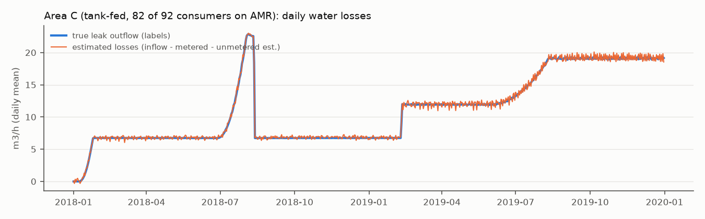
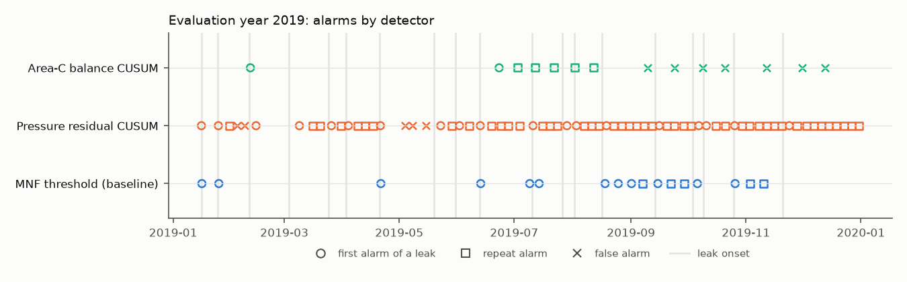

# water-leak-detection

Reproducible leak detection, water-balance and metering analytics on the public, labelled **BattLeDIM 2020 (L-Town)** benchmark.

> **Personal project on public data.** This is a self-directed study project by LUOaini1213 (MSc Civil Engineering, Transport, NUS). It uses a simulated benchmark network published for research. It is not affiliated with, endorsed by or based on the methods or data of PUB or any other water utility, and the author has not worked for a water utility.

## Why this project

Water utilities track losses with a water balance, watch minimum night flow (MNF), and increasingly use smart meters. In Singapore, PUB's Smart Water Meter Programme moves from manual meter reads to readings transmitted automatically every day, with a customer portal that alerts users to suspected leaks ([PUB press release](https://www.pub.gov.sg/Resources/News-Room/PressReleases/2021/04/PUB-appoints-SP-Services-to-install-Singapore)). This repository practises the analyses that kind of data supports, on a benchmark where the true leaks are known so every claim can be checked:

- an IWA-style **water balance** and **MNF** analysis per supply area, compared with the labelled leak outflow;
- **leak detectors** compared against a simple MNF baseline, tuned on 2018 only and evaluated on the held-out year 2019;
- rough **sensor-level localisation** and the **official BattLeDIM score** (independent Python re-implementation, checked against the organisers' published reports);
- **AMR metering analytics**: data-quality checks, consumption profiles and night-use screening.

Every number in this README is rendered from a file in [`results/`](results/) written by [`scripts/run_pipeline.py`](scripts/run_pipeline.py); a test re-renders the README and fails if any number differs.

## The benchmark in one paragraph

L-Town has 782 junctions and 905 pipes, 33 pressure sensors, 3 flow sensors and 82 AMR customer meters, all sampled every 5 minutes (105120 samples per year, 0 missing values). Reading the network topology gives three supply areas: area A (fed from two reservoirs through flow-metered pipes p227 and p235; 29 pressure sensors), area B (fed from A through a pressure-reducing valve; 1 sensor) and area C (a hilly zone supplied only by tank T1, which PUMP_1 fills from area A; 3 pressure sensors and AMR meters on 82 of its 92 consumer nodes). 14 leaks start in the training year 2018 and 19 new leaks start in the evaluation year 2019 (9 abrupt bursts, 10 slowly growing "incipient" leaks; 17 in areas A/B, 2 in area C). Another 4 leaks start in 2018 and are never repaired, so 2019 always has several leaks running.

## Results

### Water balance and minimum night flow

Area C is a closed balance: inflow = pump flow minus the change in tank storage, and most consumers are metered. The unmetered consumption of the remaining nodes is estimated from their share of nominal demand in the network model (10.4% of metered consumption). Areas A and B have metered inflow but no customer meters in the dataset, so their consumption comes from the model's nominal demands (calibrated by the metered/nominal ratio measured in area C, 0.992); the dataset documentation states those nominal demands are within 10% of actual, which gives the band shown. Rates are annual means. The "true" rows use the leak labels and are shown only for validation.

| Quantity | 2018 | 2019 |
|---|---|---|
| System input volume, whole network (m3/h) | 201.70 | 250.82 |
| Area C: system input (m3/h) | 26.84 | 34.13 |
| Area C: billed metered consumption, AMR (m3/h) | 17.61 | 17.60 |
| Area C: unmetered consumption estimate (m3/h) | 1.83 | 1.83 |
| Area C: water losses, estimated (m3/h) | 7.41 | 14.70 |
| Area C: true leak outflow from labels (m3/h) | 7.33 | 14.62 |
| Area C: water losses as % of input | 27.60 | 43.06 |
| Area C: non-revenue water as % of input | 34.41 | 48.42 |
| Areas A+B: system input (m3/h) | 174.86 | 216.69 |
| Areas A+B: losses by top-down balance (m3/h) | 19.05 | 60.89 |
| Areas A+B: band for +/- nominal-demand error (m3/h) | 3.5 to 34.6 | 45.3 to 76.5 |
| Areas A+B: losses by MNF x night-day factor (m3/h) | 18.71 | 60.21 |
| Areas A+B: true leak outflow from labels (m3/h) | 18.19 | 60.03 |
| Whole network: estimated losses as % of input | 13.12 | 30.14 |
| Whole network: true leak outflow as % of input | 12.65 | 29.76 |

- The area-C metered balance recovers the true leak outflow to within 0.07 m³/h in 2019 (0.08 m³/h in 2018); the daily series tracks the labels closely (figure below). This is what full AMR coverage of a district buys.
- For areas A and B the MNF method (night leakage = MNF minus estimated legitimate night use, scaled to a day with a night-day factor of 23.8 h from the average zone pressure, leakage exponent N1 = 0.5) is off by 0.18 m³/h in 2019 and the top-down balance by 0.87 m³/h. Both are far closer than the stated uncertainty of the nominal demands, so on real data with less accurate consumption estimates the band, not the point estimate, is the honest answer.
- Apparent losses (meter under-registration, unauthorised use) cannot be separated: the dataset contains no information on them, so all water losses are treated as real losses.



### Leak detection, evaluation year 2019

Three detectors, all run causally on daily statistics; parameters chosen on 2018 only (grid of 150 settings for the MNF baseline and 125 for the pressure CUSUM, criterion: F1 on the 2018 leak onsets):

| Detector | Chosen on 2018 |
|---|---|
| MNF threshold (baseline) | delta A+B = 20 m3/h, delta C = 8 m3/h, reference = median of the last 3 daily MNFs, at least 1 needed after an alarm |
| Pressure-residual CUSUM | k = 0.5, h = 10, reference = median of the last 14 days, at least 3 needed after an alarm |
| Area-C balance CUSUM | not tuned: k = 0.5, h = 5, reference = median of the last 7 days, at least 7 needed after an alarm |

| Method | Scope | Leak onsets | Detected | Missed | False alarms | Repeat alarms | All alarms | Median delay (h) | Detected, area-aware | False alarms, area-aware | Random alarms: detected / false |
|---|---|---|---|---|---|---|---|---|---|---|---|
| MNF threshold (baseline) | all leaks | 19 | 12 | 7 | 0 | 5 | 17 | 389.9 | 12 | 0 | 10.3 / 2.8 |
| Pressure-residual CUSUM | all leaks | 19 | 19 | 0 | 5 | 46 | 70 | 37.8 | 17 | 6 | 16.6 / 11.8 |
| Area-C balance CUSUM | area C leaks only | 2 | 2 | 0 | 7 | 5 | 14 | 282.5 | 2 | 7 | 1.2 / 10.6 |

How to read this table:

- **Detected / Missed / False alarms** use the event-matching rule in [Method](#method): an alarm counts for a leak if it falls between the leak's start and 7 days after the leak reached full size. **Repeat alarms** fall inside the window of a leak that was already detected; like the official BattLeDIM scoring, they are neither hits nor false alarms, but an operator would still have to handle them.
- Because several leaks overlap for most of 2019, a time-only rule is lenient. The last column shows what the same number of alarms placed **at random** would score (mean of 2000 simulations). The **area-aware** columns additionally require the alarm to name the right supply area (A/B or C).
- The area-C balance CUSUM watches area C only and is scored against the 2 area-C leaks; its parameters were not tuned (textbook k and h) because there are only 2 area-C leak onsets in 2018 to tune on.

What the numbers say:

- The pressure-residual CUSUM detects 19 of 19 leak onsets with a median delay of 37.8 h, against 12 of 19 and 389.9 h for the MNF baseline. It is much faster on abrupt bursts (table below).
- It is **not** better on false alarms: it raises 5 false alarms and 46 repeat alarms (70 alarms in total), while the baseline raises 0 false alarms in 17 alarms. Most repeat alarms come from incipient leaks that keep growing after the detector re-baselines.
- Compared with random alarms, the pressure CUSUM's advantage is in false alarms (5 vs 11.8 expected) and delay; its detection count (19) is only moderately above the 16.6 that the same number of random alarms would score. The baseline's 12 detections compare with 10.3 for random alarms.
- The area-C balance CUSUM catches 2 of 2 area-C leaks (the abrupt one after 10.9 h) but raises 7 false alarms in 2019 against 0 in 2018: leak outflow depends on pressure, so the day-to-day noise of the balance grows with the amount of leakage, and a noise scale estimated in 2018 is too small for 2019.

| Method | Abrupt detected | Abrupt median delay (h) | Incipient detected | Incipient median delay (h) |
|---|---|---|---|---|
| MNF threshold (baseline) | 3 of 9 | 11.5 | 9 of 10 | 543.3 |
| Pressure-residual CUSUM | 9 of 9 | 13.8 | 10 of 10 | 57.7 |

Per leak (delay in hours from leak start to the first matched alarm; "wrong area" marks hits that the area-aware rule rejects):

| Leak pipe | Type | Area | Start | MNF delay (h) | Pressure delay (h) | Balance delay (h) |
|---|---|---|---|---|---|---|
| p523 | abrupt | AB | 2019-01-15 23:00 | 7.0 | 1.0 | - |
| p827 | abrupt | AB | 2019-01-24 18:30 | 11.5 | 5.5 | - |
| p280 | abrupt | C | 2019-02-10 13:05 | missed | 82.9 (wrong area) | 10.9 |
| p653 | incipient | AB | 2019-03-03 13:10 | 1168.8 | 130.8 | - |
| p710 | abrupt | AB | 2019-03-24 14:15 | missed | 33.8 | - |
| p514 | abrupt | AB | 2019-04-02 20:40 | missed | 27.3 | - |
| p331 | abrupt | AB | 2019-04-20 10:10 | missed | 13.8 | - |
| p193 | incipient | AB | 2019-05-19 10:40 | 595.3 | 85.3 | - |
| p277 | incipient | C | 2019-05-30 21:55 | 944.1 | 50.1 (wrong area) | 554.1 |
| p142 | abrupt | AB | 2019-06-12 19:55 | missed | 4.1 | - |
| p680 | abrupt | AB | 2019-07-10 08:45 | 93.2 | 15.2 | - |
| p586 | incipient | AB | 2019-07-26 14:40 | 543.3 | 57.3 | - |
| p721 | incipient | AB | 2019-08-02 03:00 | 555.0 | 21.0 | - |
| p800 | incipient | AB | 2019-08-16 14:00 | 376.0 | 58.0 | - |
| p123 | incipient | AB | 2019-09-13 20:05 | 33.9 | 51.9 | - |
| p455 | incipient | AB | 2019-10-03 14:00 | 64.0 | 82.0 | - |
| p762 | incipient | AB | 2019-10-09 10:15 | 403.8 | 37.8 | - |
| p426 | abrupt | AB | 2019-10-25 13:25 | missed | 10.6 | - |
| p879 | incipient | AB | 2019-11-20 11:55 | missed | 84.1 | - |



Training-year performance of the chosen settings (in-sample, for reference):

| Method | Leak onsets | Detected | False alarms | All alarms | Median delay (h) |
|---|---|---|---|---|---|
| MNF threshold (baseline) | 14 | 10 | 0 | 15 | 140.7 |
| Pressure-residual CUSUM | 14 | 14 | 4 | 39 | 65.9 |
| Area-C balance CUSUM | 2 | 2 | 0 | 6 | 180.0 |

### Localisation (rough)

At each pressure-CUSUM alarm the sensors are ranked by their CUSUM statistic. For the 19 leaks the detector matched in 2019, how often is the sensor nearest to the true leak pipe (shortest path along pipes) among the top k of 33 sensors?

| k | Nearest sensor in top-k | Expected by chance |
|---|---|---|
| 1 | 8 of 19 | 0.6 |
| 3 | 10 of 19 | 1.7 |
| 5 | 10 of 19 | 2.9 |

It works for abrupt bursts (nearest sensor ranked first for 7 of 9) and poorly for slowly growing leaks (1 of 10), whose alarms are usually triggered by a different, more sensitive sensor. For the MNF baseline the only location is the supply area, which was right for 12 of 12 detected leaks.

### Official BattLeDIM score

`src/leakdet/battledim.py` re-implements the competition's scoring rules (a hit needs the right time window **and** a reported pipe within 300 m; hits earn the value of the water saved at 0.8 EUR/m³ minus a distance-weighted crew cost; false alarms cost 500 EUR). Checked against the organisers' published reports, it reproduces their example totals exactly: 523,153.82 EUR for the perfect submission (official 523,153.82) and 9,547.81 EUR for their multi-detection example (official 9,547.81).

Submitting every 2019 pressure-CUSUM alarm with the shortest pipe attached to its top-ranked sensor scores **123,563 EUR**, 23.6% of the perfect score: 10 hits, 33 false alarms and 27 repeats from 70 submissions, with 13 of 23 scored leaks never located. The leaderboard results are not comparable: competitors did not have the 2018 leak labels used here for tuning.

### Metering analytics (AMR, 2019)

What a metering team would check every day, on the 82 AMR meters (70 residential, 8 commercial, 4 industrial by dominant demand pattern in the network model). Full tables: [`results/metering_quality_2019.csv`](results/metering_quality_2019.csv), [`results/metering_night_use_2019.csv`](results/metering_night_use_2019.csv), [`results/metering_profiles_2019.csv`](results/metering_profiles_2019.csv).

- **Completeness:** 0 missing timestamps, 0 missing and 0 negative readings.
- **Zero readings:** median share 2.3% per meter; highest 10.3% on n25, an industrial user with night-time shutdowns.
- **Stuck registers:** no meter repeats the same non-zero reading for 6 h or more (longest run 1.17 h).
- **Spikes** (a reading above both neighbours by more than 20 robust standard deviations of the meter's reading-to-reading change): 2429 on 3 meters (n1, n25, n4), all industrial. Their demand jumps between operating levels, so these are review items, not proven faults.
- **Replayed data:** 74 of 82 meters report exactly the same values in 2019 as in 2018 (mean 98.6% identical readings). In real operations that would be flagged as a data-pipeline fault; here it is how the benchmark was built, and it means consumption trends between the two years cannot be studied.
- **Night use:** median night-to-day flow ratio is 0.22 for residential, 0.59 for commercial and 0.31 for industrial meters, so screening is done within each category. The classic "continuous flow" rule (no zero-flow hour in a day) fires for 81 of 82 meters, which makes it useless on this synthetic demand. A within-category robust outlier test flags n388 for review; with no ground truth for customer-side leaks this is a screening list only.
- AMR consumption is 51.6% of the water entering area C in 2019; the rest is leakage and unmetered use.

## Method

**Areas and flows.** The `.inp` file is parsed directly (no hydraulic simulation). Removing pumps and valves splits the pipe graph into the supply areas. Inflow(A+B) = p227 + p235 - PUMP_1; inflow(C) = PUMP_1 - dV/dt, with V from the T1 level and the tank diameter.

**MNF.** Daily minimum of the hourly-mean inflow over the night window (from hour 0 to hour 6); the decision for a day is available at hour 6, while the pressure and balance detectors decide at the end of the day.

**Detectors.** All re-baseline after an alarm, using only unlabelled data that arrives after it.

- *MNF threshold (baseline):* alarm when today's MNF exceeds the median of the recent MNFs since the last alarm by more than delta (separately for A+B and C).
- *Pressure-residual CUSUM:* each pressure sensor is predicted by least squares from the 6 most correlated sensors of its area (plus the T1 level in area C), fitted on the 181 hours (7.5 days) at the start of 2018 before the first training leak. Daily-mean residuals are standardised by a robust day-to-day noise scale estimated on 2018 and fed to a one-sided multivariate CUSUM (pressure drops only) against a sliding reference; an alarm fires when any sensor's statistic exceeds h.
- *Area-C balance CUSUM:* the same CUSUM on daily inflow minus metered and estimated unmetered consumption.

**Evaluation rule.** Events are leaks that start inside the evaluated year. Each has a window from its start to 7 days after its peak time (abrupt leaks peak at once, incipient leaks grow until the peak time given in the dataset), cut at the repair time. Alarms are processed in time order; an alarm inside the window of an undetected event is a hit for the earliest such event, inside windows of detected events only it is a repeat, otherwise it is a false alarm. Delay = alarm time - leak start. The 4 leaks that started in 2018 have no onset in 2019 and are excluded from this rule (the BattLeDIM score includes them).

**No test-set leakage.** Fitting and tuning go through `training_view`, which keeps only rows and leak labels before 2019-01-01; `tune()` and the residual model refuse later data. `tests/test_leakage.py` checks that scrambling all 2019 data and labels leaves the tuned parameters unchanged, and that the guards raise.

**What could not be computed.** Authorised consumption in areas A and B (no customer meters), apparent losses (no meter-error data), infrastructure leakage index and economic level of leakage (no pipe ages, service connection counts or cost data beyond the competition's), and hydraulic-model-based localisation (EPANET is not run).

## Limitations

- **Simulated network.** Demands, leaks and sensors are synthetic and noise-light; the median day-to-day noise of the daily pressure residuals is 0.59 mm, which real sensors and models would not achieve. Results here are likely optimistic compared with what the same methods would achieve on a real network.
- **2019 was looked at during development.** The evaluation script was run on 2019 several times while the pipeline was being debugged. The detector design was then fixed, and every parameter is chosen by the 2018 criterion stored in [`results/tuning_2018.json`](results/tuning_2018.json), but this is not a strictly single-shot test.
- **Training labels.** Tuning uses the 2018 leak labels released after the competition; competitors only had a repair report. Scores are therefore not comparable with the BattLeDIM leaderboard.
- **Lenient time-only matching.** With many overlapping leaks, random alarms already score many hits; read the detection counts next to the random-alarm and area-aware columns.
- **Alarm volume.** The pressure detector raises 70 alarms in 2019 for 19 leak onsets. Grouping repeat alarms by sensor would reduce this but was not designed or tuned, so it is not claimed.
- **Daily granularity.** Decisions are made once a day (MNF in the morning, pressure and balance at midnight), so the delay depends on when in the day a leak starts; a leak starting just after a decision waits up to a day.
- **Localisation** is sensor-level only and weak for incipient leaks.

## How to run

Python 3.11. Commands from the repository root:

```bash
python -m venv .venv            # or: uv venv --python 3.11 .venv
.venv/Scripts/python -m pip install -r requirements.txt   # Linux/macOS: .venv/bin/python
python scripts/fetch_data.py    # downloads the CSV files from Zenodo, checks MD5 and SHA-256
python scripts/run_pipeline.py  # writes results/ (a few minutes)
python scripts/render_readme.py # README.md from docs/README.template.md + results/
python -m pytest                # offline tests on committed fixtures and results
python scripts/mutation_test.py # mutation testing of the test suite
```

## Repository layout

```
src/leakdet/      io, network (.inp parser, areas, distances), waterbalance, features,
                  detectors, train (tuning with training-only guard), evaluation,
                  battledim (official scoring rules), metering
scripts/          fetch_data, run_pipeline, figures, render_readme, mutation_test
results/          every number in this README (JSON/CSV) and the figures
tests/            pytest suite; fixtures/ holds small derived data for offline CI
data/manifest.json  dataset files, sizes, MD5 and SHA-256 (raw files are not committed)
docs/             README template and source list
```

## Quality checks

84 tests pass offline in CI. The test suite was itself mutation-tested: 24 deliberate bugs were injected one at a time into the source, and the suite caught 24 of them ([`results/mutation_report.json`](results/mutation_report.json) lists each mutant and whether it survived).

## Data, licences and sources

- **Data:** *Dataset of BattLeDIM: Battle of the Leakage Detection and Isolation Methods*, Vrachimis et al., Zenodo, [DOI 10.5281/zenodo.4017659](https://doi.org/10.5281/zenodo.4017659), licence [CC BY 4.0](https://creativecommons.org/licenses/by/4.0/). The raw files (about 189 MB) are not committed; `scripts/fetch_data.py` downloads them and checks them against [`data/manifest.json`](data/manifest.json). The committed derived files in `results/` and `tests/fixtures/` (including a compressed copy of the network file `L-TOWN.inp`) are adaptations of that dataset under the same licence.
- **Scoring reference:** the official BattLeDIM scoring code and example reports, [KIOS-Research/BattLeDIM](https://github.com/KIOS-Research/BattLeDIM) (EUPL-1.2). [`src/leakdet/battledim.py`](src/leakdet/battledim.py) is a Python port of that MATLAB code, so it is a derivative work and is distributed under EUPL-1.2 (full text in [`LICENSES/EUPL-1.2.md`](LICENSES/EUPL-1.2.md)), as is the fixture of its example submissions and published totals, `tests/fixtures/battledim_reference.json`.
- **Code:** MIT licence, see [LICENSE](LICENSE), except `src/leakdet/battledim.py` and `tests/fixtures/battledim_reference.json`, which are EUPL-1.2 (see above).
- Full source list with retrieval dates: [`docs/sources.md`](docs/sources.md).
